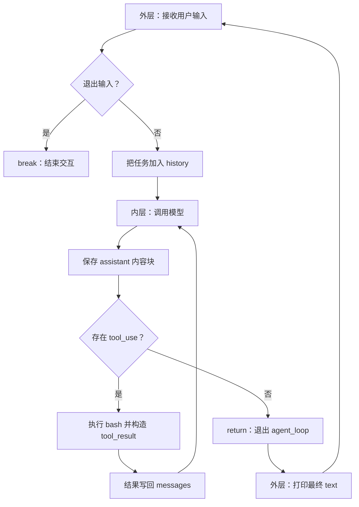
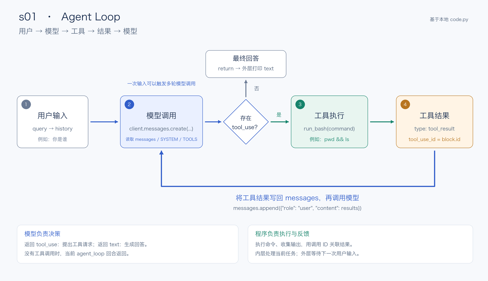

# Agent 循环与工具调用

> 创建时间：2026-10-12 15:50:55 +08:00
> 更新时间：2026-10-12 18:09:06 +08:00
> 状态：已总结（s01 核心源码与日志、s02 工具分发及本次问答；实践仍待补全）
> 实践状态：部分复现（用户提供 s01 工具调用日志；其他实验未运行）
> 学习优先级：快速复习，必须实作
> 说明：已合并本次源码学习问答与用户运行日志；助手未重跑模型调用，不将单个样例标为全分类完成

## 1. 本分类目标与来源

目标：调用模型、收集工具请求、关联结果、决定退出；工具 schema、handler 分发、文件路径与工具错误。

- 总入口：[学习计划](./README.md)；协作规则：[AGENTS.md](./AGENTS.md)。
- 本地基线：`ce8f9f1`；实际学习时重新记录 HEAD，定位符号后再解释调用关系。
- 本次检查：2026-10-12，HEAD 为 `cafaacbc37e8dd293ea0d0a978e686219cc84301`；工作区 `s01_agent_loop/code.py` 已有用户未提交的日志改动。本文按当前工作区解释，行号可能随编辑变化。
- 运行证据：用户在本会话提供的 `2026-10-12 16:43:49,144` 完整对话历史；SDK 字段在本地 `agent` 环境的 `anthropic 1.4.0` 中已核对。
- 字段参考：[工具调用与结果](https://platform.claude.com/docs/en/agents-and-tools/tool-use/handle-tool-calls)、[Thinking 与签名](https://platform.claude.com/docs/en/build-with-claude/thinking)，本会话检查日期为 2026-10-12。
- 网页辅助：[教程入口](https://learn.shareai.run/zh/s01/)，按主题查找对应页，记录实际页面 URL 与日期；不照搬网页版编号。

| 本地章节 | 阅读材料 | 实现入口 | 待追踪符号 | 阅读 / 实践 |
| --- | --- | --- | --- | --- |
| s01 Agent Loop | [中文 README](../s01_agent_loop/README.zh.md) | [code.py](../s01_agent_loop/code.py) | `agent_loop / run_bash` | 已总结（核心源码与日志） / 部分复现（用户日志） |
| s02 Tool Use | [中文 README](../s02_tool_use/README.zh.md) | [code.py](../s02_tool_use/code.py) | `TOOL_HANDLERS / agent_loop / safe_path / run_glob` | 已总结 / 未记录运行证据；glob 行尾注释已完成静态验证 |

符号列表是阅读入口；s01、s02 的调用链与证据范围见各自小节，实际源码关系以本次工作区为准。

## 2. 逐章学习区

### s01 Agent Loop

#### 2.1.1 怎样开始读源码

- 本章要解决的问题：调用模型、收集工具请求、关联结果、决定退出。
- 阅读顺序：`if __name__ == "__main__"` → `agent_loop()` → `run_bash()` → 工具结果写回 → 最终文本打印。
- 当前工作区定位：入口 131 行，外层循环 136 行；`agent_loop` 97 行，内层循环 98 行；`run_bash` 81 行；完整历史日志 150 行。以符号为主，行号只辅助定位。
- 阅读状态：核心源码与日志结构已总结；实践状态：用户日志中已观察到一个完整工具调用样例，助手未重新调用模型。

#### 2.1.2 为什么有两个 while True

| 循环 | 职责 | 每轮处理 | 正常退出 |
| --- | --- | --- | --- |
| 入口的外层循环 | 命令行持续接收任务 | 一次用户输入、一次 `agent_loop(history)`、打印最终文本 | `q` / `exit` / 空字符串，或输入处 EOF / Ctrl+C，执行 `break` |
| `agent_loop` 的内层循环 | 持续处理当前任务 | 一次模型调用，随后执行该响应中的工具请求并写回 | `tool_calls` 为空时 `return`，回到调用方 |

一个用户任务可以产生多次模型调用。内层运行期间，外层正在等待函数返回；两个循环是同步嵌套执行。输入处的 Ctrl+C 被捕获，不代表代码为所有模型调用和工具执行都实现了完整取消处理。



停止调用工具只说明当前回合返回，没有独立的目标完成验收。本章没有设置内层循环的总轮次上限；`max_tokens=8000` 限制单次响应输出，不是整个任务的调用次数或总预算。

#### 2.1.3 history 与 messages 为什么都在变

下面省略函数体，只展示定义与传参关系；完整执行逻辑见源码。

```python
# 函数接收到同一个列表对象
def agent_loop(messages: list):
    ...

history = []
# 外层：加入本次用户任务
history.append({"role": "user", "content": query})
agent_loop(history)
```

传参没有复制列表，`messages` 和 `history` 指向同一对象；函数中的 `messages.append(...)` 会改变外面的 `history`。这里只讨论实际使用的原地修改；若函数把 `messages` 重新赋值为另一个列表，则是另一种行为。

`history` 在外层循环之前创建，连续提问会保留此前对话。程序重新启动会重新创建空列表，本章没有把历史自动恢复为跨进程会话。

| 核心变量 | 含义 | 生命周期 / 观察重点 |
| --- | --- | --- |
| `query` | 本次用户输入 | 外层每轮读取新输入 |
| `history` / `messages` | 对话历史 | 同一列表持续追加消息 |
| `SYSTEM` | 角色与环境说明 | 单独传给模型，不在这份 history 日志里 |
| `TOOLS` | 工具说明与参数 schema | 告诉模型可以请求什么，不执行命令 |
| `response` | 本轮完整 SDK 响应 | 每轮重新赋值；含 content、停止原因及 usage 等 |
| `response.content` | 本轮内容块列表 | 可同时包含 thinking、tool_use、text 等 |
| `tool_calls` | 筛选出的工具请求 | 看是否为空以及请求了什么 |
| `block` | 遍历时的一个内容块 | 根据 type 判断种类 |
| `block.input["command"]` | bash 命令参数 | 即将交给本地 Shell 执行 |
| `output` | 本地命令返回文本 | stdout/stderr 或错误说明 |
| `results` | 本轮工具结果列表 | 每轮新建，并使用 ID 配对 |

#### 2.1.4 核心调用链与五个代码位置



重点看下方的蓝色回路：工具结果通过 tool_use_id 关联请求，写回 messages 后再次调用模型。每轮响应先保存为 assistant 消息，再检查其中是否有 tool_use；没有工具调用时返回外层并打印最终 text。图片按用户要求保存在 notes/images，尺寸为 2600 × 1500；[绘图源码](./images/s01-agent-loop.py)可用于重生成，绘图不运行 Agent。

```text
input → history.append(user) → agent_loop(history)
  → client.messages.create → messages.append(assistant)
  → 筛选 tool_use
      有请求：run_bash → subprocess.run → 构造 results → 写回 messages → 再调用模型
      无请求：return → 入口遍历最终内容块并打印 text → 等待新输入
```

| 代码位置（符号优先） | 作用 | 调试时看什么 |
| --- | --- | --- |
| `client.messages.create`（当前 99 行） | 把历史、系统说明、工具定义发给模型 | 请求参数；返回后展开 response.content |
| `messages.append(assistant)`（105 行） | 保存模型响应，包括工具请求 | 历史中新增的 assistant 消息 |
| `if not tool_calls`（111 行） | 决定当前回合是否返回 | tool_calls 是否为空 |
| `run_bash(...)`（118 行） | 真正执行模型生成的命令 | block.input、output；进入 run_bash 看 subprocess |
| `messages.append(user/results)`（127 行） | 让下一次模型调用看到执行结果 | tool_use_id、结果文本、列表长度 |

模型返回 `tool_use` 是请求，本地程序调用 `run_bash` 才产生实际行动。工具响应使用 `role="user"` 是 Anthropic 消息协议的承载方式，不表示用户又手动输入了一次。

当前 run_bash 拼接 stdout 和 stderr，未把 subprocess 的 returncode 纳入返回值；错误文字也没有自动设置 tool_result.is_error。研究失败路径时应把“函数返回了文本”和“命令退出码为 0”分开核对。

#### 2.1.5 block 到底是什么

`block` 是普通变量名，表示当前遍历到的一个内容块，可以改名为 `content_block`。

```python
for block in response.content:
    print(block.type)
```

在用户的第一次模型响应中，第一个 block 是 `ThinkingBlock`，第二个是 `ToolUseBlock`。`tool_calls` 只留下 `block.type == "tool_use"` 的块。

```text
history：多条消息
  └─ message：role + content
       └─ content：字符串，或内容块列表
            ├─ ThinkingBlock：thinking
            ├─ ToolUseBlock：tool_use
            ├─ tool_result 字典：工具结果
            └─ TextBlock：text
```

`ThinkingBlock(...)` 等是 SDK 对象的 Python 打印形式，`None` 也是 Python 值；整段原日志不是标准 JSON。下面统一转换为字典只为理解结构，实际 history 仍包含 SDK 对象与手工构造的字典。

| 内容块 | 字段 | 含义 |
| --- | --- | --- |
| ThinkingBlock | `type`、`thinking`、`signature` | 类型、API 返回的思考文本、不透明签名；显示内容依赖模型与配置 |
| ToolUseBlock | `type`、`id`、`name`、`input` | 类型、调用标识、工具名、工具参数 |
| ToolUseBlock | `caller`、`toolset_name` | 调用来源与工具集合信息；本例均为 None |
| tool_result | `type`、`tool_use_id`、`content` | 类型、对应请求 ID、执行结果；可选 is_error，本例没有 |
| TextBlock | `type`、`text`、`citations` | 类型、回答文本、引用信息；本例 citations 为 None |

签名不需要解析；向 API 回传思考块时保持原样。s01 保留整个 `response.content`，但循环控制只检查工具块，不解析思考文字。参考本文件来源中的官方 Thinking 文档。

#### 2.1.6 真实日志：统一整理为一个完整嵌套字典

证据来源：用户粘贴的 `2026-10-12 16:43:49,144 - agent - INFO - code.py:150 - Full conversation history`。下面把 SDK 内容块对象展开成普通 Python 字典，保留日志中的字段、文本、调用 ID、签名和命令输出。外层 `conversation["history"]` 是教学用包装，并非 s01 真实 history 的额外层，也不是完整 API response。

```python
conversation = {
    "history": [
        # 消息 1：用户输入
        {
            "role": "user",
            "content": "你是谁",
        },

        # 消息 2：模型第一次响应，两个内容块
        {
            "role": "assistant",
            "content": [
                {
                    "type": "thinking",
                    "signature": "2a3b940d-077e-496a-ace2-072f471e1c8c",
                    "thinking": (
                        'The user asks "你是谁" (Who are you?). '
                        "I should respond as a coding agent. "
                        "Let me maybe look at the project to understand context. "
                        "The instruction says act, don't explain. "
                        "But this is a simple identity question. "
                        "Let me check the directory briefly."
                    ),
                },
                {
                    "type": "tool_use",
                    "id": "call_00_c3YswniSgYake1f2BX5X7737",
                    "name": "bash",
                    "input": {
                        "command": "pwd && ls",
                    },
                    "caller": None,
                    "toolset_name": None,
                },
            ],
        },

        # 消息 3：程序执行 bash 后构造的工具结果
        {
            "role": "user",
            "content": [
                {
                    "type": "tool_result",
                    "tool_use_id": "call_00_c3YswniSgYake1f2BX5X7737",
                    "content": (
                        "/Users/cyt/projects/i/agent-framework/"
                        "learn-claude-code/s01_agent_loop\n"
                        "README.ja.md\n"
                        "README.md\n"
                        "README.zh.md\n"
                        "__pycache__\n"
                        "code.py\n"
                        "hello.py\n"
                        "images"
                    ),
                },
            ],
        },

        # 消息 4：模型第二次响应，包含最终文本
        {
            "role": "assistant",
            "content": [
                {
                    "type": "thinking",
                    "signature": "c5891448-db05-4382-be03-40ddca0109b8",
                    "thinking": "Let me give a brief answer about who I am.",
                },
                {
                    "type": "text",
                    "citations": None,
                    "text": (
                        "我是运行在这个终端里的编码 agent（Claude Code 风格）。"
                        "我在当前目录 "
                        "`/Users/cyt/projects/i/agent-framework/"
                        "learn-claude-code/s01_agent_loop` 下工作，"
                        "可以用 bash 工具读写文件、运行命令来帮你完成编码任务。"
                        "\n\n"
                        '这个目录看起来是 "learn-claude-code" 系列的第一个示例：'
                        "agent loop。需要我做什么？"
                    ),
                },
            ],
        },
    ],
}
```

括号内相邻字符串自动拼接，`\n` 表示换行，None 表示此字段没有值。转换为标准 JSON 时 None 会成为 null；理解用字典不应被误认为实际模型原始网络响应。

**逐层取值：字典 → 消息列表 → 消息字典 → 内容块列表 → 内容块字典。**

```python
history = conversation["history"]
assistant_message = history[1]             # 第 2 条消息
block = assistant_message["content"][1]    # 工具请求块

print(block["type"])                      # tool_use
print(block["name"])                      # bash
print(block["input"]["command"])          # pwd && ls

result = history[2]["content"][0]          # 第 3 条消息的工具结果
print(block["id"] == result["tool_use_id"])  # True

final_block = history[3]["content"][1]     # 第 4 条消息的文本块
print(final_block["text"])
```

| 实际 SDK 对象 | 理解用字典 | 含义 |
| --- | --- | --- |
| `block.type` | `block["type"]` | 内容块类型 |
| `block.input["command"]` | `block["input"]["command"]` | 命令参数；SDK 对象里的 input 本身就是字典 |
| `block.id` | `block["id"]` | 工具调用 ID |
| `block.text` | `block["text"]` | text 类型的文本；其他类型不一定有此字段 |

本次日志共有 4 条消息、2 次模型响应和 1 次工具调用，对应内层正常完成两轮。`pwd && ls` 是一个工具调用里的两个 Shell 命令，不是两个 ToolUseBlock。

```text
user：你是谁
assistant：thinking + tool_use（bash / pwd && ls）
user：tool_result（同一个调用 ID / 工作目录和文件列表）
assistant：thinking + text（最终回答）
```

日志前缀的时间、logger 名称 agent、级别 INFO、code.py:150 是程序日志元数据。日志没有完整 response 的 id、model、stop_reason、usage，也没有单独传入的 SYSTEM 和 TOOLS；不能据此编造模型版本、token 使用量或每轮具体停止原因。

完整 SDK response 可在模型调用返回后观察 `response.id`、`response.model`、`response.content`、`response.stop_reason`、`response.usage`。工具调用 id 与 response.id 是不同层次的标识。

#### 2.1.7 调试问题与推荐观察位置

用户先前截图显示 PyCharm 在初始化时进入 IronPython 控制台兼容分支，触发 Python 2 的 exec 语法错误。会话检查发现运行目录为 s01_agent_loop，本地 code.py 抢先匹配了标准库 code；调试器需要的 InteractiveConsole / InteractiveInterpreter 因而未能正常导入。

已新增 [s01-module 调试配置](../.run/s01-module.run.xml)：模块名 `s01_agent_loop.code`，工作目录为仓库根目录，使用项目 agent 解释器。助手已在该环境（Python 3.10.20）验证标准库 code 与 PyCharm 控制台模块可导入；未验证 IDE 实际断点连接。截图中的错误不是“断点没有命中”的充分原因描述，具体根因是模块命名与搜索路径冲突。

参考：[Python 模块搜索路径](https://docs.python.org/3/tutorial/modules.html#the-module-search-path)。调试配置若移动或删除，应同步调整上面的链接。

先选 s01-module 并输入简单任务。推荐断点：外层 history.append、模型返回后的 messages.append、if not tool_calls、run_bash 调用、工具结果写回。使用 Step Over 越过 SDK 调用；需要研究命令执行时再 Step Into 自己的 run_bash。断点停在某行通常意味着该行尚未执行，要观察 append 后的列表需再单步一次。

课程“试一下”已核对：创建 hello.py、列出 Python 文件、查看 Git 分支三个 prompt。当前用户日志只覆盖身份提问中触发 pwd/ls 的样例；hello.py 文件存在也不能替代其创建流程的运行证据，这三项仍待分别记录。

### s02 Tool Use

#### 2.2.1 本章解决什么问题与来源

s01 只有 bash，文件操作需要模型生成 Shell 命令；s02 增加四个专用工具，用名字映射到处理函数。模型提出结构化请求，宿主查表执行，工具结果继续进入原有 Agent Loop。

- 本地事实来源：[README.zh.md](../s02_tool_use/README.zh.md)、[code.py](../s02_tool_use/code.py)、[原教学图](../s02_tool_use/images/tool-dispatch.svg)。
- 已有资料：[s02 项目总结](../s02_tool_use/总结.md)仅作辅助，事实按源码复核；保留该文件，本次不覆盖。
- 网页扩展：[s02 Tool Use](https://learn.shareai.run/zh/s02/)，本会话 2026-10-12 已检查；并发安全、连续分批位于“深入 CC 源码”，本地教学实现没有该调度器。
- 基线：HEAD cafaacbc37e8dd293ea0d0a978e686219cc84301；s02 code.py 工作区已有本次会话添加的 run_glob 中文行尾注释，执行逻辑未改。
- 阅读状态：已总结。实践状态：未记录 s02 的真实调用 Trace；不能仅凭 test.py 或总结.md 存在就标为已复现。

#### 2.2.2 本地教学图与整体流程


图片直接引用本地课程 `s02_tool_use/images/tool-dispatch.svg`。重点看橙色 TOOL_HANDLERS 区域：通过工具名选择对应函数；左侧 tool_result 回路把执行结果追加到 messages。图中的五个工具是总量，新增的是四个专用文件工具；“循环不变”指保留模型 → 工具 → 结果的控制结构，不表示两个源码文件逐字相同。

```text
用户输入 → history → agent_loop
  → 模型读取 SYSTEM、TOOLS 与 messages
  → 保存完整 assistant 响应
  → 按原顺序筛选 tool_use
      无请求：return → 打印最终 text
      有请求：逐个查 TOOL_HANDLERS
          → handler(**block.input)
          → 构造与 block.id 配对的 tool_result
  → 整批 results 作为 user 消息写回 → 再调用模型
```

#### 2.2.3 工具定义、注册与执行

| 工具名 | 本地函数 | 主要参数 | 行为 |
| --- | --- | --- | --- |
| bash | run_bash | command | 同步执行 Shell 命令，返回 stdout/stderr 文本 |
| read_file | run_read | path、可选 limit | 读 UTF-8 文本；limit 控制返回行数 |
| write_file | run_write | path、content | 创建父目录，写入并覆盖文件内容 |
| edit_file | run_edit | path、old_text、new_text | 查找旧文本，只替换第一个匹配位置 |
| glob | run_glob | pattern | 匹配路径，过滤、去重、排序并限制展示数量 |

`TOOLS` 是发给模型的能力描述（name、description、input_schema）；`TOOL_HANDLERS` 是本地工具名到函数对象的映射。加一个可运行工具需要实现函数、声明 schema 并注册映射；单加描述不会让工具自动执行。

```python
TOOL_HANDLERS = {
    "bash": run_bash,
    "read_file": run_read,
    "write_file": run_write,
    "edit_file": run_edit,
    "glob": run_glob,
}

# 当前源码的工具分发；以下为相关片段
handler = TOOL_HANDLERS.get(block.name)
output = handler(**block.input) if handler else f"Unknown: {block.name}"
results.append({
    "type": "tool_result",
    "tool_use_id": block.id,
    "content": output,
})
```

例如 block.name 为 read_file，block.input 为 `{"path": "README.md", "limit": 20}`，`**block.input` 就将字典展开成命名参数，相当于 `run_read(path="README.md", limit=20)`。注册表存的是函数对象，不是提前执行后的返回值。

源码定位：WORKDIR 在 44 行，safe_path 在 81 行，run_glob 在 120 行，TOOLS 在 138 行，TOOL_HANDLERS 在 153 行，agent_loop 在 163 行，实际分发在 180–183 行。行号按本次检查记录，后续以符号搜索为准。

架构思想是函数式 Dispatch Map / Registry-like：模型输出名称，字典选择实现。它降低循环与具体工具的耦合，便于扩展；代价是工具描述与映射要保持一致，校验、权限和异常策略仍需明确。本实现没有工具类继承关系，使用原教学流程图表达，不伪造 UML 类。

#### 2.2.4 提问：glob 有什么用

glob 解决“符合模式的路径在哪里”，read_file 解决“文件里面写了什么”。它匹配路径而不是搜索文本内容；返回值可能包含匹配的目录，当前函数没有进一步调用 is_file。

| pattern | 范围（相对于 WORKDIR） |
| --- | --- |
| `*.py` | 当前这一层的 .py 路径 |
| `src/*.py` | src 这一层的 .py 路径 |
| `**/*.py` | 当前目录及多层子目录的 .py 路径 |
| `**/*logger*.py` | 各层名称中带 logger 的 .py 路径 |

`*` 匹配单个路径段内的字符；recursive=True 让模式中的 `**` 能递归匹配。仅设置 recursive=True 不会使 `*.py` 自动跨所有子目录。参考：[Python glob 文档](https://docs.python.org/3/library/glob.html)，本会话已核查。

如果后一个工具参数需要依据找到的路径决定，正常过程是：模型请求 glob → 宿主返回路径 → 下一次模型调用看到结果 → 生成 read_file 请求。这属于跨模型回合的数据依赖。

#### 2.2.5 提问：逐行理解 run_glob

[本地函数](../s02_tool_use/code.py)的每个代码行已添加中文行尾注释，本次会话已验证 Python 语法与修改前后的可执行 AST 一致；这项检查没有运行模型。

```python
def run_glob(pattern: str) -> str:
    import glob as g
    try:
        matches = sorted({
            match for match in g.glob(
                pattern, root_dir=WORKDIR, recursive=True)
            if (WORKDIR / match).resolve().is_relative_to(WORKDIR)
        })
        shown = matches[:200]
        if len(matches) > 200:
            shown.append("... (more matches omitted; narrow the pattern)")
        return "\n".join(shown) if shown else "(no matches)"
    except Exception as e:
        return f"Error: {e}"
```

| 代码 / 语法 | 含义与边界 |
| --- | --- |
| pattern: str、→ str | 参数和返回类型提示，不自动执行运行时类型校验 |
| import glob as g | 模块别名；g.glob 是标准库函数 |
| root_dir=WORKDIR | 相对模式从启动时工作目录查找，不保证所有输入都被限制在该目录 |
| 集合推导式 `{match for ... if ...}` | 遍历匹配结果，保留满足条件的路径并去重 |
| WORKDIR / match | Path 的路径拼接运算；绝对路径右操作数会覆盖前面的目录 |
| resolve() | 解析绝对路径、.. 与符号链接，用于后面的路径位置检查 |
| is_relative_to(WORKDIR) | 检查解析后的路径等于或位于工作目录之下 |
| sorted(...) | 按路径字符串排序，返回列表 |
| matches[:200] | 新建前 200 条的展示列表，不限制完整搜索量 |
| shown.append(...) | 超过 200 条时加截断提示，完整 matches 不受影响 |
| join(shown) if shown else ... | 非空则以换行拼接，空列表则返回无匹配提示 |
| except Exception as e | 将传播出来的普通异常转成 Error 字符串工具结果 |

集合推导式可展开成下面的等价理解片段：

```python
raw_matches = g.glob(pattern, root_dir=WORKDIR, recursive=True)
unique_matches = set()
for match in raw_matches:
    full_path = (WORKDIR / match).resolve()
    if full_path.is_relative_to(WORKDIR):
        unique_matches.add(match)
matches = sorted(unique_matches)
```

返回的是原 match 字符串，full_path 只用于检查。路径过滤发生在 glob 扫描之后，因此不等于扫描前的沙箱限制。glob 也可能在内部忽略扫描错误，不能假定所有目录访问问题都会进入该 except。

#### 2.2.6 提问：模型返回有顺序，为什么还讨论并发

三个层次需要分开：模型返回有顺序的请求列表；TOOL_HANDLERS 选择执行函数；宿主执行器决定是否同步等待。本地列表筛选保留原顺序，for 循环中的同步 handler 返回后才开始下一个。

| 情况 | 判断 |
| --- | --- |
| 一次响应返回多个 tool_use | 多请求，不表示已执行或已并发 |
| read A、read B，文件稳定且互不依赖 | 可考虑重叠执行，减少 I/O 等待 |
| write B 后 read B | 读取应等待写入完成，保留顺序 |
| 两次修改同一文件 | 需要避免覆盖和读改写竞争，通常串行 |
| 后续参数依赖前一个结果 | 通常先反馈结果，再由下一轮模型生成请求 |

有列表顺序不意味着每一项都有业务依赖，但也不能将模型的排列当作完整依赖声明。串行是当前课程的保守实现；并发是宿主增加的调度优化，既不增加模型调用，也不等于多 Agent。

#### 2.2.7 提问：isConcurrencySafe 与连续分区算法

网页附录描述按具体输入判断并发安全，再将连续安全调用分批。此机制没有进入当前本地 s02 Python 实现。并发安全关注共享资源、操作行为与依赖，不等同只读性，也不替代权限检查。

同样是 bash，ls、rm、`ls && rm x` 行为不同；不能只按工具名或命令前缀认定安全。不同任务记录的写入，在独立 ID 与共享状态同步等条件满足时也可能并发；不能由“写不同文件”直接推导所有写操作安全。

```text
原始请求：[read A, read B, glob *.py, bash rm x, read C]
                ↓ 按顺序扫描
batch 1（安全批次）：read A、read B、glob 并发
                ↓ 等该批完成
batch 2（单独批次）：bash rm x
                ↓ 等该批完成
batch 3（安全批次）：read C，只有一个调用
```

分区不是先收集全部读操作再处理写操作。安全调用仅与紧邻的最后一个安全批次合并；非安全调用各自新建一个批次，形成顺序边界。下面是自行改写的教学等价示意，不是 TS 原文，也不执行工具：

```python
def partition_tool_calls(tool_calls, is_safe):
    batches = []
    for call in tool_calls:
        safe = is_safe(call)
        if safe and batches and batches[-1]["parallel"]:
            batches[-1]["calls"].append(call)
        else:
            batches.append({"parallel": safe, "calls": [call]})
    return batches
```

这是按顺序线性扫描的批次划分。执行器另行控制批内并发上限、批间等待、异常与结果配对；完成顺序可能不同，tool_use_id 必须正确关联原请求。若用 asyncio.to_thread 配合同步工具，gather 可汇总结果；仅添加 async 关键字不会自动使阻塞函数并发。参考：[Python asyncio 文档](https://docs.python.org/3/library/asyncio-task.html)。并发示例与性能数字未实际测量。

#### 2.2.8 提问：教程引用的 CC TypeScript 文件在哪里

本次会话已检查本地仓库，未找到 toolOrchestration.ts；本地 s02 教学代码是 Python。2026-10-12 的网页核查找到第三方仓库的同名文件，但教程没有标明仓库和 commit，不能确认其引用的是同一份快照。

| 链接 | 定位 / 阅读内容 |
| --- | --- |
| [官方 anthropics/claude-code](https://github.com/anthropics/claude-code) | 当前公开仓库没有所述完整核心 TypeScript 文件 |
| [第三方 codeaashu/claude-code](https://github.com/codeaashu/claude-code) | README 自称保存泄露源码，不是官方发布的开源核心实现 |
| [第三方 toolOrchestration.ts](https://github.com/codeaashu/claude-code/blob/main/src/services/tools/toolOrchestration.ts) | 本会话已读到相同分区机制；阅读时搜索函数名，不固定使用截图行号 |

该文件的分区函数会先检查输入 schema，安全判断失败或抛异常时按非安全处理。阅读顺序可用 partitionToolCalls（分批）→ runTools（逐批调度）→ runToolsConcurrently / runToolsSerially（执行）。这些是快照中读到的实现，不证明当前 Claude Code 产品完全保持相同行为。

#### 2.2.9 课程练习、源码边界与自测

本地 README 的四个“试一下”已核对，以下均待补运行证据：

| 课程练习 | 观察重点 | 状态 |
| --- | --- | --- |
| 读取 README.md，解释项目 | read_file 的参数、结果与下一轮回答 | 待记录 |
| 创建 test.py，再读回 | 写读先后顺序、两个调用 ID 与结果 | 待记录 |
| 查找目录中的 Python 文件 | glob 模式、结果及范围 | 待记录 |
| 读 README 与 requirements，再创建总结文件 | 独立读请求和结果反馈后的写入决策 | 待记录 |

源码边界：read/write/edit 使用 safe_path；glob 对返回路径单独过滤；Shell 不受同一套路径限制。README 及已有自动总结中的“rm -rf / 仍可执行”与当前源码字面不一致：当前 run_bash 的危险字符串列表会拦截该字符串，但不能据此视为完整权限系统或沙箱。

其他边界：input_schema 描述工具参数，当前本地 handler 前没有独立的严格 schema 验证；错误参数展开可能在进入工具函数前抛 TypeError。未知名称会成为 Unknown 字符串。read_file 的 limit 限制返回行数，但先读取全文；write_file 输出中的 bytes 实际使用 len(content)，对中文并非 UTF-8 字节数。这里只记录事实，本次不修改功能。

自测题为本次自拟：

1. TOOLS 与 TOOL_HANDLERS 分别面向谁？答题思路：前者描述模型可请求的能力，后者把名字连接到本地函数。
2. 为什么是 handler(**block.input)？答题思路：输入字典展开成命名参数，键名必须与函数参数匹配。
3. glob 与 read_file 有何区别？答题思路：查找路径与读取内容；后续调用可能依赖查找结果。
4. recursive=True 为什么不使 *.py 搜索所有子目录？答题思路：递归模式需要 **；普通 * 不跨路径分隔符。
5. sorted({ ... })、matches[:200] 与 join 分别做什么？答题思路：去重排序、限制展示、新行拼接为工具结果。
6. 多个 tool_use 是否表示并发？答题思路：只表示多个请求，本地同步 for 决定串行执行。
7. 为什么 read C 不能随意跨过中间写操作？答题思路：连续分批保留顺序边界，防止改变可观察语义。
8. isConcurrencySafe 为 true 是否表示操作已获授权？答题思路：并发调度与权限是独立判断。
9. 教程行号能否当作官方最新源码位置？答题思路：需要仓库、commit 与版本依据；当前只能确认第三方快照中的相同机制。

- [ ] 对照教学图说明工具请求如何查表分发并回写。
- [ ] 自己解释 run_glob 的推导式与路径边界。
- [ ] 记录一个实际多工具调用的 Trace 和 ID 配对。
- [ ] 在一次性目录修改一个自制工具，记录参数错误或工具失败。
- [ ] 手工推演连续分批；实际并发实现作为后续拓展。

## 3. 阅读时先回答的问题

1. 模型输出工具参数，为什么不等于工具已经执行成功？
2. tool_use 与 tool_result 怎样通过 ID 配对？多次工具调用的结果怎样写回？
3. 本地循环检查工具块，网页版示例检查 stop_reason：本地实现怎样处理没有工具调用的响应？

## 4. 实验计划与证据

以下均为待运行方案；实际实验采用 AGENTS.md 的记录字段，逐项保存环境、命令、输入、状态变化、结果与失败分析。

1. 原示例：在一次性目录创建并读取一个测试文件，记录每轮消息与工具结果。
2. 修改：自行增加一个只读的文件统计工具，并为循环加入可配置轮次上限。
3. 失败：文件不存在、工具参数不合法或命令超时，观察实际返回与后续行为；先读实现再判断。

### 已观察记录：身份提问触发 bash

- 状态：用户提供日志，已观察；助手未重新调用模型。
- 日期：2026-10-12 16:43:49,144 +08:00；时区按本会话客户端时间记录，原日志没有显式时区字段。
- 入口：s01_agent_loop/code.py；日志打印位置为当时的 150 行。
- 本次源码 HEAD：cafaacbc37e8dd293ea0d0a978e686219cc84301，工作区含用户日志改动；该 HEAD 是总结时基线，不假定为用户运行瞬间的 commit。
- 环境：会话检查的 PyCharm 项目解释器为 agent / Python 3.10.20，SDK 为 anthropic 1.4.0；用户日志本身未包含环境版本。
- Provider / 模型 / 启动命令：日志未提供，未确认；不因回答自称 Claude Code 风格就判断实际模型身份。
- 输入：你是谁。
- 实际工具：bash，参数 command 为 pwd && ls。
- 实际结果：返回工作目录与文件列表；随后第二次模型响应给出最终回答。
- 状态变化与完整内容：见 2.1.6 的完整字典；调用 ID 与结果 ID 一致。
- 命令退出码、token、时延和费用：这份日志未提供。
- 修改实验 / 异常场景：自制工具、轮次上限、超时等尚未运行。
- 工程启发：简单提问也可能触发工具调用；是否调用由当前模型响应及请求配置决定。需要从实际内容块判断，不能预设每个身份问题都会执行命令。

### 后续实验

前面的三个方案保持待运行。下一次可选择一个只读任务，在断点和日志中核对每次 append 前后的消息长度，再补充命令退出码与错误场景。

## 5. 工程边界与 HelloAgents 对照

- 阅读前需注意的课程边界：s01 的最小 Shell 实现和字符串拒绝列表只能用于理解机制；路径校验的覆盖范围需要对照每个工具检查。
- 工程迁移方向（建议）：业务工具要明确参数、输出和失败语义；模型提出意图，宿主负责校验与执行。
- HelloAgents 对照：待回查已有笔记，链接相关概念，重点补充本课程的实现差异。
- 架构思想（s01）：感知结果 → 决策 → 行动 → 反馈的运行时循环。模型生成工具请求，宿主控制执行与消息写回，位置是 agent_loop 与 run_bash；收益是控制流简洁，代价是历史持续增长、失败处理有限、缺少总预算和目标验收。本实现以函数与消息为主，使用流程图表达，不伪造类图。
- 架构思想（s02）：TOOLS 声明能力、TOOL_HANDLERS 注册函数、agent_loop 查表分发；收益是扩展工具时少改控制流，代价是描述与实现同步维护，校验、权限、错误处理需要单独设计。详见 2.2.3。

## 6. 总结、验收与自测

| 已总结知识 | 本次结论 |
| --- | --- |
| 两个循环 | 外层接收新任务，内层为当前任务反复调用模型；return 返回调用方，break 结束外层 |
| 共享历史 | history 与 messages 指向同一列表，append 原地修改；results 每轮重新创建 |
| 内容块 | block 是遍历变量，type 决定块类型；对象属性与字典下标要区分 |
| 行动与反馈 | tool_use 是请求，run_bash 执行，tool_result 按 ID 关联并写回 |
| 证据范围 | 本例证明一次工具闭环已观察到，不证明全部实验或目标可靠验收已完成 |
| 工具分发 | schema 描述能力，映射选择函数，`**block.input` 展开命名参数，本地仍同步执行 |
| glob | 按模式查路径，过滤、去重、排序、最多展示 200 条；不读取正文，也不限制扫描量 |
| 顺序与依赖 | 模型返回有序列表，宿主决定调度；独立请求可重叠，有依赖的操作保留顺序 |
| 连续分批 | 只合并紧邻的并发安全调用，非安全调用各自成批，分区与执行分开 |
| 图与版本 | s02 原教学 SVG 直接引用；网页 TS 算法是扩展，第三方快照不是官方最新实现证明 |

以下是用户掌握与实践验收清单，保留未勾选以便亲自验证：

- [ ] 画出用户 → 模型 → 工具 → 结果 → 模型的循环。
- [ ] 独立写出工具分发并实际调用一个自制工具。
- [ ] 用真实记录解释继续、停止与工具失败的区别。

s02 的逐项掌握清单与自测答案见 2.2.9；已总结不等于所有实践验收项已完成。

自测题为本分类自拟，未冒充官方习题：

1. 模型输出工具参数，为什么不等于工具已经执行成功？答题思路：模型只返回请求；宿主调用 run_bash 后才得到实际结果，错误信息也需要写回。
2. tool_use 与 tool_result 怎样通过 ID 配对？多次工具调用的结果怎样写回？答题思路：block.id 对应 tool_use_id；本轮每个请求生成一个结果，results 整批追加为 user 消息。
3. 本地循环检查工具块，网页版示例检查 stop_reason：本地实现怎样处理没有工具调用的响应？答题思路：tool_calls 为空便 return；入口只打印最终响应中的 text，不独立验证目标。
4. 为什么 messages.append 会改变 history？答题思路：二者引用同一个列表；结合模型请求与工具结果的追加位置解释。
5. block 是工具、消息还是内容块？答题思路：它是遍历到的一个内容块变量，需检查 type；一个 assistant 消息可以包含多个块。
6. 日志里的四条消息对应几次模型调用？答题思路：两条 assistant 响应对应两次调用，中间的 user/tool_result 由程序构造。
7. 为什么不能从这份 history 读取模型版本和 token 用量？答题思路：代码只保存 role 与 response.content，完整 response 的 model 和 usage 未进入日志。

## 7. TODO 与会话交接

- 最后学习位置：s02 的 TOOLS / TOOL_HANDLERS / agent_loop / run_glob；s01 的双循环、完整日志字典与 PNG 已保留。
- 本次完成：总结 s02 与全部相关提问，直接嵌入本地 tool-dispatch.svg，补充 schema、参数展开、glob、串行/并发、分批与 TS 来源、自测及课程练习；README 已加入本地教学图片规则。
- 已验证证据：s01 用户日志与调试器导入检查来自前次会话；s02 的 glob 注释已做语法与 AST 一致性检查，当前源码与 SVG 关系已静态核对。本轮未运行模型、Shell 工具或课程示例。
- 当前问题：实际 Provider/模型、token、退出码未记录；s02 的真实 Trace、自制工具、并发实现和失败场景仍待实验。
- 下次第一步：运行一个 s02 只读任务，记录 glob 或双读取的 handler、block.input、tool_use_id 与结果；补完实践后进入 s03。
- 需要用户补充：无；实际运行时若配置不齐再按需处理。

