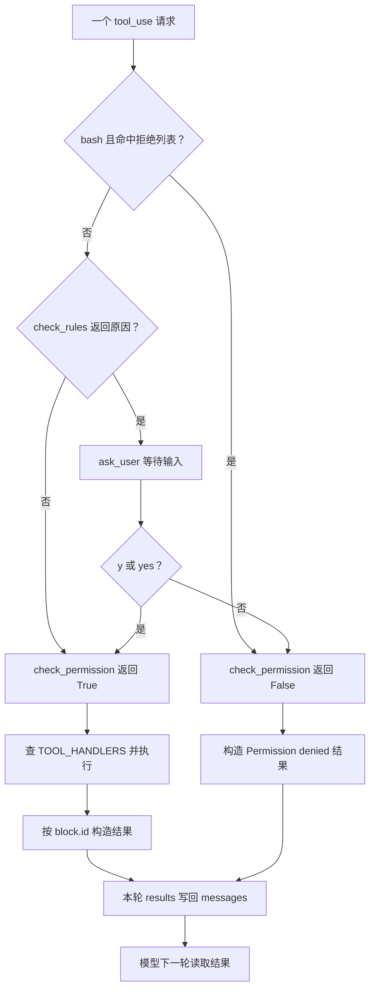
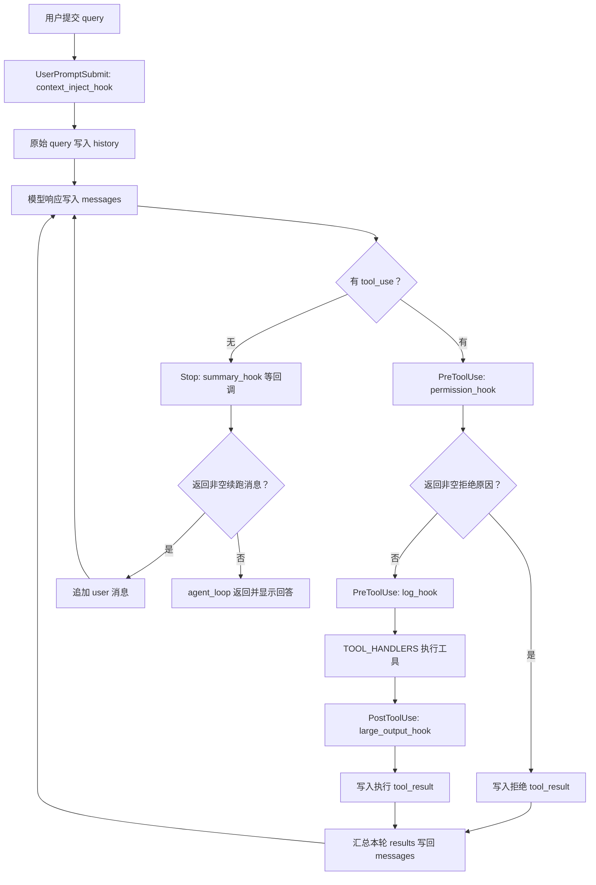

# 权限控制与生命周期 Hooks

> 创建时间：2026-10-12 15:50:55 +08:00
> 更新时间：2026-10-12 21:01:56 +08:00
> 状态：s03 / s04 已总结；实践待补证据
> 实践状态：未记录运行证据（助手本轮未运行课程；用户 Trace 待补）
> 学习优先级：重点深入
> 说明：按本地源码合并 s03 / s04 问答并引用课程原图；静态阅读与运行复现分别记录

## 1. 本分类目标与来源

目标：权限判断的顺序、允许/拒绝/询问以及执行边界；权限与日志怎样挂在生命周期位置。

- 总入口：[学习计划](./README.md)；协作规则：[AGENTS.md](./AGENTS.md)。
- 本地基线：`ce8f9f1`；实际学习时重新记录 HEAD，定位符号后再解释调用关系。
- 本次检查：2026-10-12，HEAD 为 cafaacbc37e8dd293ea0d0a978e686219cc84301；以下按当前工作区 s03_permission/code.py 与 s04_hooks/code.py 分析，包含本地修改，行号仅辅助定位。
- s03 来源：[本地中文教程](../s03_permission/README.zh.md)、[实现](../s03_permission/code.py)、本会话中关于 lambda 路径规则的提问。工程建议与待运行实验另行标注。
- s04 来源：[本地中文教程](../s04_hooks/README.zh.md)、[实现](../s04_hooks/code.py)、本会话 Hook Workbench 截图与代码问答。
- 网页辅助：[s04 学习页](https://learn.shareai.run/zh/s04/)与 [Claude Code 官方 Hooks 参考](https://code.claude.com/docs/en/hooks)，检查日期为 2026-10-12；网页版按主题对照，不照搬版本、编号或事件数量。

| 本地章节 | 阅读材料 | 实现入口 | 待追踪符号 | 阅读 / 实践 |
| --- | --- | --- | --- | --- |
| s03 Permission | [中文 README](../s03_permission/README.zh.md) | [code.py](../s03_permission/code.py) | `check_deny_list / check_permission / check_rules / ask_user` | 已总结 / 未记录运行证据 |
| s04 Hooks | [中文 README](../s04_hooks/README.zh.md) | [code.py](../s04_hooks/code.py) | `HOOKS / register_hook / trigger_hooks / permission_hook / summary_hook / agent_loop` | 已总结 / 未记录运行证据 |

s03 的权限管线与 s04 的注册、触发、短路、反馈和停止路径均已静态核对；下文不将阅读结论标为运行成果。

本地原图阅读顺序：先看 s03 总览中的“门放在哪里”，再看 s03 管线中的“门怎样决定”，最后看 s04 总览中的“检查怎样挂到事件上”。

| 原图入口 | 回答的问题 | 对应笔记 |
| --- | --- | --- |
| [s03 权限框架总览](../s03_permission/images/permission-overview.svg) | 权限检查怎样连接模型、工具和结果？ | 2.1.1 |
| [s03 三道闸门](../s03_permission/images/permission-pipeline.svg) | 硬拒绝、询问、允许的顺序是什么？ | 2.1.2 |
| [s04 Hooks 框架总览](../s04_hooks/images/hooks-overview.svg) | 执行前后如何触发注册的扩展？ | 2.2.2 |

## 2. 逐章学习区

### s03 Permission

#### 2.1.1 核心问题：执行前由宿主做决定

s02 提供工具分发，s03 在每个工具实际执行之前插入 check_permission。模型负责提出调用意图；宿主根据策略决定直接允许、询问用户或拒绝。system prompt 中的约束是给模型的说明，真正阻止 handler 调用的是程序控制流。


来源为本地 s03_permission/images/permission-overview.svg。重点看 check_permission 位于模型响应与 TOOL_HANDLERS 之间：拒绝也要构造 tool_result 回写，不能只在控制台打印。图中“循环不变”指核心结构保留，不代表工具实现与 s02 逐字相同；文件路径策略的变化见 2.1.6。

#### 2.1.2 三道闸门与返回值


来源为本地 s03_permission/images/permission-pipeline.svg。重点看硬拒绝优先、规则命中后询问、规则未命中默认允许。图里的“读敏感路径”是概念说明；当前文件规则实际判断的是工作区内外，没有单独的敏感路径名单。

| 闸门 / 函数 | 检查范围 | 返回值 | 后续行为 |
| --- | --- | --- | --- |
| 1：check_deny_list | 仅 bash；命令中是否含 DENY_LIST 字符串 | 原因字符串或 None | 命中直接拒绝，不进入用户确认 |
| 2：check_rules | 适用工具的规则条件 | 首条匹配规则的 message 或 None | 有原因则进入闸门 3；无原因默认放行 |
| 3：ask_user | 命中规则的工具调用 | allow 或 deny 字符串 | y/yes 允许；其他输入拒绝，回车默认拒绝 |
| 总入口：check_permission | 按上面顺序协调检查 | True 或 False | True 才调用 handler；False 回写拒绝结果 |

三个容易混淆的“真值”必须分开：rule.check(args) 为 True 表示命中需询问规则；check_rules 返回非空原因字符串表示需询问；check_permission 为 True 才表示允许执行。



没有命中拒绝列表和规则时采用默认允许。这是当前教学策略，不等于每个放行调用都已经被证明安全。

#### 2.1.3 关键源码与执行链

| 位置（本次行号） | 符号 | 关注点 |
| --- | --- | --- |
| 156–162 | DENY_LIST / check_deny_list | 子串匹配，硬拒绝优先 |
| 166–172 | DESTRUCTIVE_COMMAND_WORD / contains_destructive_command | rm/del 命令词的大小写与部分分隔符识别 |
| 175–183 | PERMISSION_RULES | 适用工具、条件函数、原因文字 |
| 185–189 | check_rules | 首个命中就返回，不累积所有原因 |
| 193–197 | ask_user | strip、lower 与默认拒绝 |
| 201–212 | check_permission | bool 的最终放行决策 |
| 236–246 | agent_loop 中的权限入口 | 拒绝结果、continue、工具执行与反馈 |

核心入口摘录：

```python
def check_permission(block) -> bool:
    if block.name == "bash":
        reason = check_deny_list(block.input.get("command", ""))
        if reason:
            return False

    reason = check_rules(block.name, block.input)
    if reason:
        decision = ask_user(block.name, block.input, reason)
        if decision == "deny":
            return False

    return True
```

该片段省略了控制台提示，保留实际决策顺序。硬拒绝不会被后续用户同意覆盖；用户审批只服务于第二道闸门的规则匹配。

```python
# agent_loop 的相关片段；其他逻辑见源码
for block in tool_calls:
    if not check_permission(block):
        results.append({
            "type": "tool_result",
            "tool_use_id": block.id,
            "content": "Permission denied.",
        })
        continue

    handler = TOOL_HANDLERS.get(block.name)
    output = handler(**block.input) if handler else f"Unknown: {block.name}"
```

continue 只跳过当前工具请求，不退出整个 Agent Loop；随后还会检查本轮其他请求。拒绝结果使用原调用 ID，让模型知道哪个工具没有被执行。当前结果没有设置 is_error，也没有独立审计记录。

#### 2.1.4 用户提问：lambda 路径规则是什么意思

```python
check_outside = lambda args: not (
    WORKDIR / args.get("path", "")
).resolve().is_relative_to(WORKDIR)
```

lambda 定义匿名函数，args 是工具参数字典；定义时不执行，调用 `rule["check"](args)` 时才计算。上面的表达式等价于：

```python
def is_outside_workspace(args):
    path = args.get("path", "")
    full_path = (WORKDIR / path).resolve()
    is_inside = full_path.is_relative_to(WORKDIR)
    return not is_inside
```

| 表达式 | 含义 |
| --- | --- |
| `args.get("path", "")` | 有键则取值，缺少键则使用空字符串；存在但为 None 不会自动换成默认值 |
| WORKDIR / path | Path 的路径拼接；右侧绝对路径会覆盖前面的目录 |
| resolve() | 解析为绝对路径，处理 .. 与符号链接 |
| is_relative_to(WORKDIR) | 判断解析后的路径等于工作目录或位于其下 |
| not | 取反，所以越界为 True，工作区内为 False |

假设 WORKDIR 是 /project，且没有改变解析结果的符号链接，以下是逻辑推演，不是文件访问实验：

| args 中的 path | 解析后的路径 | is_relative_to | 最终规则结果 | 当前策略 |
| --- | --- | --- | --- | --- |
| A.py | /project/A.py | True | False | 该规则不触发询问 |
| src/B.py | /project/src/B.py | True | False | 该规则不触发询问 |
| ../outside.txt | /outside.txt | False | True | 询问用户，不自动拒绝 |
| /tmp/test.txt | /tmp/test.txt | False | True | 询问用户，不自动拒绝 |
| 缺少 path 键 | /project | True | False | 规则未命中，但不代表参数有效 |

缺少 path 后是否能执行，还取决于 handler 的必填参数。规则没有替代 schema 校验；非字符串等非法输入也可能使路径表达式抛异常。

这条规则适用于 read_file、write_file、edit_file。当前代码的 message 写成 Writing outside workspace，但它也会在越界读取时触发；中文 README 示例用 Access outside workspace。理解时按 tools 与条件判断，不能只看提示文字。

#### 2.1.5 拒绝列表、破坏性命令与默认审批

DENY_LIST 使用简单、大小写敏感的子串检查，命中 rm -rf /、sudo 等会直接返回 False。它没有完整解析 Shell 命令；例如包含 rm -rf /tmp/demo 的字符串也包含 rm -rf /，可能被更宽泛地硬拒绝。这里只解释匹配，不执行这些命令。

第二道闸门的 bash 条件由两个检查以 or 连接：正则尝试识别命令开头或部分分隔符后的 rm/del（不区分大小写），另加 rm 空格、写入 /etc/、chmod 777 的字符串匹配。这仍是教学启发式，不是完整 Shell 语法分析，可能有误判或漏判。

审批代码把输入 strip().lower() 后，只接受 y、yes；Y/YES 也会被接受。空输入和其他文字返回 deny。用户同意意味着宿主愿意调用工具，不会赋予进程新的操作系统文件访问权限，也不保证工具成功。

#### 2.1.6 与 s02 的差异及工程边界

| 机制 | s02 当前实现 | s03 当前实现 |
| --- | --- | --- |
| 工具分发 | TOOL_HANDLERS 查表 | 保留查表，前面增加权限入口 |
| bash 拒绝列表 | 位于 run_bash 内 | 移入 check_permission 的第一道闸门 |
| read/write/edit 越界 | safe_path 直接抛异常，工具转 Error | 不再调用 safe_path，越界在规则层询问；同意后可以尝试执行 |
| glob | 匹配后过滤工作区外路径 | 同样有结果过滤，未进入该文件路径询问规则 |
| 工作区内普通写入 | 直接写入 | 文件越界规则未命中，通常直接允许；不是所有写入都要询问 |
| 拒绝反馈 | 依赖工具内部返回 | 权限层生成 Permission denied 并配对工具 ID |

因此 README 的“从 s02 保留”要按具体函数核对；本章确实改变了文件访问策略。路径检查是应用层策略，不是完整 OS 沙箱；检查到执行之间的状态也可能改变，不能把 resolve 检查描述成不可绕过的隔离。

当前权限入口未包住所有参数解析和审批异常，用户在 ask_user 处 EOF/Ctrl+C、错误参数导致检查异常等行为待实验；不能把“未命中规则默认允许”描述为“异常一律拒绝”。默认允许策略、审计与非交互运行应在实际业务中另行设计（工程建议）。

架构思想是执行前的 Policy Gate / 按顺序短路的规则管线：check_permission 协调检查，check_deny_list 与 check_rules 提供判断，ask_user 收集决定。收益是规则集中在工具执行前，模型输出不直接等于行动；代价是规则覆盖有限、与 CLI input 耦合、无法直接服务无人值守任务。实现以函数与规则字典协作为主，用流程图说明，不伪造工具类继承或 GoF 类图。s04 再研究如何把这些步骤挂到 Hooks。

#### 2.1.7 课程练习与待补证据

本地 README 的“试一下”已核对。所有结果以下仅为代码推演预期，未运行：

| 课程练习 | 预期关注点 | 证据状态 |
| --- | --- | --- |
| 当前目录创建 test.txt | write_file 工作区内通常直接通过 | 待记录真实调用与落盘 |
| 删除 test.txt | 普通 bash rm 触发规则询问，拒绝时不得执行 | 待记录请求、审批与结果 |
| 列出当前目录 | 普通 ls 无匹配时直接通过 | 待记录实际命令与结果 |
| 尝试写 /etc/something | 文件越界会询问；同意也可能因系统权限失败 | 待记录；先用一次性工作区外测试目录验证等价路径判断 |
| Windows del / DEL 与非命令词对照 | 命令词匹配大小写；model、delimiter、echo del 不应被该正则当成删除命令 | 当前 macOS，Windows 执行未验证 |

实验时记录工作目录、工具名、参数、reason、用户输入、权限 bool、是否实际调用 handler、文件状态与 tool_result ID。s03/test.txt 存在不证明它由模型创建，也不证明删除、拒绝或审批路径已经验证。

#### 2.1.8 本章总结与自测

| 知识点 | 核心结论 |
| --- | --- |
| 责任边界 | 模型提出请求，宿主负责执行前的策略判断 |
| 三道闸门 | 硬拒绝优先，规则命中才问用户，无匹配默认允许 |
| True 的含义 | rule.check 为 True 表示需询问；check_permission 为 True 才允许 |
| lambda | 工具参数 → 路径解析 → 工作区关系判断 → 取反 |
| 拒绝后的循环 | 构造对应 ID 的 tool_result，continue 跳过当前 handler |
| 实际策略 | s03 文件越界可经用户确认放行，和 s02 safe_path 的强制拒绝不同 |

自拟问题与答题思路：

1. 为什么只在 SYSTEM 写禁止规则不够？宿主需要在 handler 前真正检查和控制调用。
2. check_rules 为什么返回 str 或 None？字符串提供询问原因，None 表示未命中，最终决策由 check_permission 协调。
3. lambda 返回 True 为什么不是允许？它是“越界”的条件谓词，True 表示规则匹配并进入审批。
4. 硬拒绝能否被用户输入 yes 覆盖？不能；第一道闸门已经 return False。
5. 缺少 path 为什么没有触发越界规则？默认空字符串解析成 WORKDIR，但参数缺失仍需独立校验。
6. 拒绝一个工具为什么用 continue 而不是 return？跳过当前请求，继续检查其他请求，最后统一反馈。
7. 用户确认后为什么仍可能执行失败？进程权限、文件状态、参数和工具执行错误仍然存在。
8. s03 是否继承 s02 文件越界必拒绝？没有；read/write/edit 改成规则询问，不能机械照搬原结论。

- [ ] 手工说明 allow / ask / deny 三条路径及各函数返回值。
- [ ] 在断点观察一个被拒绝请求确实未进入 handler。
- [ ] 用一次性目录验证越界拒绝与用户同意后的不同结果。
- [ ] 记录一次无效参数或审批中断的真实行为。
- [ ] 核对拒绝结果与原工具调用 ID，向模型反馈并观察下一轮。

### s04 Hooks

#### 2.2.1 核心问题：给稳定循环预留扩展点

s03 在工具执行前直接调用 check_permission。继续增加日志、结果检查和收尾行为时，如果每项都写进 agent_loop，主循环就会承担越来越多的业务细节。s04 让主流程在指定阶段触发事件，由 HOOKS 注册表决定执行哪些回调。

**Hook 是在预定生命周期节点自动执行的回调。** 模型提出工具请求后，宿主触发 PreToolUse；工具返回后，宿主触发 PostToolUse。Hook 可以观察、记录或参与控制流程，但实际能做什么取决于宿主给它的参数和返回值协议。

| 对比 | Tool（工具） | Hook（钩子） |
| --- | --- | --- |
| 谁决定调用 | 模型在响应中提出 tool_use | 宿主执行到对应事件位置自动触发 |
| 注册入口 | TOOLS 描述能力；TOOL_HANDLERS 映射实现 | HOOKS 的事件名映射回调列表 |
| 典型任务 | 读文件、写文件、执行命令 | 权限检查、日志、输出检查、收尾统计 |
| 调用参数 | 模型生成的 block.input | 事件现场的 query、block、output 或 messages |
| 结果如何使用 | 通过 tool_result 反馈给模型 | 由事件调用方解释；可能打印、拦截或续跑 |

两者在本地都能用 Python 函数实现，也都可能产生副作用。区别在触发方式和职责，而不是“是不是函数”。Hook 无须先被模型选为工具，当前回调也没有注册到 TOOLS 中。

#### 2.2.2 本地框架图与网页工作台怎么读


来源：本地 s04_hooks/images/hooks-overview.svg，直接引用课程提供的中文 SVG。重点看 PreToolUse 在 handler 前、PostToolUse 在 handler 后；权限拒绝走 tool_result 分支，模型下一轮可以看到拒绝原因。

**读图时对照源码的三个细节：** 原图重点展示工具前后两个事件，完整代码还有 UserPromptSubmit 和 Stop；“循环一字不改”应理解为建立扩展点后增加回调无须继续改循环，s03→s04 的接入本身仍修改了循环；图中“非 None → 阻止”是简写，外层实际还用 if blocked 判断真值，见 2.2.5。

用户提供的 Hook Workbench 截图可这样理解：左侧 Hook registry 是注册表，不是正在运行的工具列表；四个卡片表示四个事件槽位，PreToolUse 下有 permission_hook 和 log_hook 两个回调。右侧 This turn 是这一轮输入与审计信息。截图处于 1/6，只有注册信息，不能据此判断工具已经执行。

实际执行依次经过：输入 → 输入事件 → 模型 → 执行前事件 → handler → 执行后事件 → 结果回写 → 模型；没有工具请求时进入 Stop 判断。



该图对应当前默认回调；工具有多个时，在 for block in tool_calls 中逐个执行，没有并发调度。

#### 2.2.3 核心变量与调用链

| 符号 / 位置 | 阅读时关注什么 |
| --- | --- |
| HOOKS、register_hook、trigger_hooks（137–147 行） | 事件 → 有序回调列表；注册和触发相互分开 |
| permission_hook（162 行起） | 返回 None 表示不阻止；非空字符串说明拒绝原因 |
| 五次 register_hook（215–219 行） | 4 个事件、5 个回调；权限注册在日志之前 |
| agent_loop 的 blocked（247 行起） | 是否跳过 handler；拒绝时仍保存 block.id |
| agent_loop 的 output 与 results（253–260 行） | 工具输出、后置事件、tool_result、批量回写顺序 |
| agent_loop 的 force（238–241 行） | Stop 返回的续跑内容是否追加为 user 消息 |
| 主入口的 history / query（267–278 行） | 跨用户轮次共享历史；输入事件在调用模型前触发 |

注册结束后，字典的含义是：

```python
# 值是函数对象列表，不是字符串列表，也不是已经执行后的返回值。
HOOKS = {
    "UserPromptSubmit": [context_inject_hook],
    "PreToolUse": [permission_hook, log_hook],
    "PostToolUse": [large_output_hook],
    "Stop": [summary_hook],
}
```

register_hook("PreToolUse", permission_hook) 传递的是函数本身，没有括号，因此只注册、不执行。以后 trigger_hooks("PreToolUse", block) 才会调用 permission_hook(block)。这些注册语句在脚本模块加载时执行，位于 agent_loop 外部。

#### 2.2.4 trigger_hooks：有序调用与短路

```python
def trigger_hooks(event: str, *args):          # event 选事件；args 收集本次事件的参数
    for callback in HOOKS[event]:             # 按注册顺序遍历这个事件的回调
        result = callback(*args)              # 展开参数并调用函数
        if result is not None:               # 第一个非 None 结果就让分发器停止
            return result                    # 返回给事件调用方解释
    return None                              # 都没有结果时返回 None
```

例如传入 block、output 时，args 是二元组 (block, output)，callback(*args) 等价于 callback(block, output)。各事件参数必须和该事件回调的签名一致；代码没有自动适配参数。

对用户“按字典事件命名触发所有 Hook，所以不算硬编码”的理解，需要补充两点：**只遍历该事件的回调，且遇到非 None 就提前返回，并不保证全部执行。** 事件名称和触发位置仍是主流程预先写好的；从主循环移出去的是 permission_hook 等具体行为的直接依赖。

以当前 PreToolUse 为例：permission_hook 返回 None → 执行 log_hook → 执行工具；permission_hook 返回拒绝字符串 → log_hook 不执行 → 工具不执行 → PostToolUse 不执行 → 回写拒绝结果。因此，log_hook 的名字和注释虽称记录每个调用，当前顺序实际上不会记录被前一个权限 Hook 拦截的请求。

#### 2.2.5 返回值没有统一含义：要看调用方

| 事件 | 传入参数 | 当前代码怎样使用返回值 | 当前默认回调 |
| --- | --- | --- | --- |
| UserPromptSubmit | query | 未接收返回值；原始 query 继续写入历史 | 打印工作目录 |
| PreToolUse | block | if blocked 为真时，写拒绝结果并 continue | 先权限检查，再日志 |
| PostToolUse | block, output | 未接收返回值；原 output 继续写入结果 | 大输出提醒 |
| Stop | messages | if force 为真时，追加 user 消息并继续模型循环 | 累计工具结果统计 |

不能把 trigger_hooks 中的英文注释“A hook result blocks this tool call”泛化到所有事件。分发器只返回结果；阻止工具或要求续跑的具体控制流发生在调用方。

另一个边界是 **非 None 与真值不等价**：回调返回 False 或空字符串时，分发器会短路后续回调，但 if blocked / if force 为假，工具仍可能执行或本轮仍会停止。当前学习代码宜遵守清晰约定：无动作返回 None；拒绝或续跑返回非空字符串。若做工程改造，建议使用结构化结果并统一分发器与调用方判断，而不是混用 bool、字符串和 None。

UserPromptSubmit 和 PostToolUse 即使返回字符串，也不会自动修改输入或输出；最多在分发器内部短路同事件的后续回调。要实现这些能力，需扩展宿主的返回值处理协议。

#### 2.2.6 context_inject_hook 与终端颜色

```python
def context_inject_hook(query: str):
    print(f"\033[90m[HOOK] UserPromptSubmit: working in {WORKDIR}\033[0m")
    return None
```

该函数实际只在控制台打印工作目录，没有使用 query，没有修改 SYSTEM、messages 或 history。因此当前实现没有向模型注入上下文；不要仅根据函数名或教程注释推断行为。真正注入需要把信息加入模型输入，并明确宿主如何合并。

| 片段 | 中文含义 |
| --- | --- |
| \033 | Python 字符串中的八进制转义，表示 ESC 控制字符（十进制 27） |
| [90m | 与 ESC 合起来构成 ANSI SGR 指令，通常显示为灰色 / 亮黑色 |
| [HOOK] ... {WORKDIR} | 实际要显示的文本；f-string 填入工作目录 |
| \033[0m | 重置终端样式，避免后续文字也保持灰色 |

颜色是终端显示效果，不是给模型的字段；不支持 ANSI 的控制台可能显示转义内容或忽略样式。

#### 2.2.7 summary_hook：统计工具结果，不生成模型摘要

summary_hook 在 Stop 事件中接收整份 messages，遍历 content 为列表的消息，计数字典块中 type == "tool_result" 的条目，再打印累计数。源码已有中文逐行注释，完整实现见 [summary_hook 所在文件](../s04_hooks/code.py)。

更容易读懂的等价展开如下（理解用，不替换源码）：

```python
def count_tool_results(messages):
    tool_count = 0
    for message in messages:
        content = message.get("content")
        if not isinstance(content, list):
            continue                          # 用户普通字符串消息不参与逐块计数
        for block in content:
            if isinstance(block, dict) and block.get("type") == "tool_result":
                tool_count += 1               # 每个结果块加 1，不检查成功与否
    return tool_count
```

假设第一轮有 1 个成功结果，第二轮新增 1 个拒绝结果，则累计统计是 1、2。拒绝和错误也会作为 tool_result 被统计；该数字不等于成功执行次数。assistant 里的 SDK ToolUseBlock 对象不满足这里的字典过滤条件。

Stop 是当前一次 agent_loop 准备返回的节点，不等于关闭整个 CLI 会话。外层 history 会保留给下一轮，因此统计跨轮次累计。输入 q/exit/空字符串时，主入口直接 break，并没有调用这个 Stop Hook。summary_hook 返回 None 也不会主动请求续跑。

#### 2.2.8 “还要改 Loop，Hook 有什么好处？”

用户指出的接入成本是存在的：最初建立事件扩展点时，确实必须修改主循环。收益是以后在已有位置增加行为时，只定义回调并 register_hook，不必不断给 agent_loop 添加权限、日志等具体函数调用。

| 变更需求 | 当前已有 Hook 后是否还需改主流程 |
| --- | --- |
| 工具执行前增加耗时起点或参数审计 | 可注册 PreToolUse 回调；通常无须再改 agent_loop |
| 工具返回后记录输出长度 | 可注册 PostToolUse 回调 |
| 新增 SessionStart 事件 | 需要新增事件槽位和实际触发位置 |
| 输入 Hook 返回改写后的 query | 当前调用方忽略返回值，需要修改主入口的合并逻辑 |
| 给工具失败单独触发事件 | 需要定义失败协议并改执行分支 |

这里适合称为“事件注册表 + 顺序回调管线”：主流程提供扩展位置，回调实现具体策略。代码只有函数和字典，不需要强造类图。代价是调用关系间接、回调顺序影响行为、协议不清晰时难排查。

#### 2.2.9 中文事件速查与学习优先级

截图中的“27 个”属于网页引用的源码快照；2026-10-12 检查的官方参考页还有其他事件，数量不宜背成固定 API 事实。以下保留截图中的事件，中文用途按生命周期理解；官方能力需以安装版本和 [Hooks 参考](https://code.claude.com/docs/en/hooks) 为准。优先级是本笔记的学习建议。

**第一层：现在重点掌握四个事件及本地调用位置。**

| 事件 | 触发时机 | 学习重点 |
| --- | --- | --- |
| UserPromptSubmit | 用户提示提交、模型处理前 | 输入与上下文入口；区分日志和实际注入 |
| PreToolUse | 工具执行前 | 权限、参数校验、拦截后反馈 |
| PostToolUse | 工具成功返回后（官方） | 输出检查、审计；本地未单独区分失败事件 |
| Stop | 当前回答准备结束 | 收尾与续跑条件；区别于 SessionEnd |

**第二层：做失败处理和会话管理时再展开。**

| 事件 | 中文含义 / 时机 | 用途举例（学习建议） |
| --- | --- | --- |
| PostToolUseFailure | 工具调用失败后 | 记录错误原因与恢复线索 |
| PermissionRequest | 工具需要权限决定时 | 集中组织审批策略 |
| PermissionDenied | 官方 auto 模式拒绝工具时 | 追踪自动拒绝；不泛化为所有拒绝 |
| SessionStart | 会话开始或恢复 | 初始化、加载项目背景 |
| SessionEnd | 会话终止 | 保存会话记录、资源收尾 |
| StopFailure | API 错误导致本轮结束 | 记录请求失败；不是 Stop Hook 自身抛错 |
| Notification | 系统发出通知时 | 呈现等待、审批等状态 |

**第三层：学到对应章节或产生需求时再查。**

| 类别 | 事件 | 中文含义与用途 |
| --- | --- | --- |
| 初始化 | Setup | 显式初始化 / 维护入口；区别于普通会话开始 |
| 子 Agent | SubagentStart | 子 Agent 创建时，记录委派 |
| 子 Agent | SubagentStop | 子 Agent 结束时，记录返回状态 |
| 压缩 | PreCompact | 压缩前，检查重要信息 |
| 压缩 | PostCompact | 压缩后，检查上下文衔接 |
| 团队 | TeammateIdle | 队友准备空闲时，检查后续任务 |
| 任务 | TaskCreated | 创建任务时，校验任务信息 |
| 任务 | TaskCompleted | 标记任务完成时，设置验收条件 |
| MCP 交互 | Elicitation | MCP 服务请求用户补充信息时 |
| MCP 交互 | ElicitationResult | 用户回复送回服务前 |
| 配置 | ConfigChange | 配置变化时，审计变更 |
| 工作区 | WorktreeCreate | 创建 worktree 时，自定义创建过程 |
| 工作区 | WorktreeRemove | 移除相应 worktree 时，做收尾 |
| 指令 | InstructionsLoaded | CLAUDE.md 或规则文件加载到上下文时 |
| 目录 | CwdChanged | 工作目录变化时，更新环境信息 |
| 文件 | FileChanged | 被配置监视的文件发生变化时 |

相同的是“事件触发扩展”的模式，各事件输入、决策能力和结果协议并不相同。官方的 JSON、退出码等协议不能直接套用为本地 callback 返回字符串的协议；本地 HOOKS 也尚未实现表中其他事件。

#### 2.2.10 教程简化、版本差异与代码边界

| 容易按文字推断的结论 | 当前源码实际行为 |
| --- | --- |
| context_inject_hook 注入上下文 | 只打印 WORKDIR，主入口忽略返回值 |
| large_output_hook 压缩输出 | 仅在字符串长度超过 100000 时打印提醒，不裁剪结果 |
| 每个工具请求都有 log_hook 日志 | 权限回调先注册，被拒绝会跳过后续日志回调 |
| PostToolUse 只对应成功 | 本地 handler 返回 Error 字符串也会走它；没有独立失败事件 |
| Hook 报错不影响主流程 | trigger_hooks 没有 try/except，异常向调用方传播 |
| 多个 Hook 自动并发 | 当前按注册顺序同步调用；input 审批还会暂停执行 |
| Stop 保证最终结束 | 回调若持续返回非空续跑内容，可能一直循环；未设置次数上限 |

网页学习页以 stop_reason 判断停止，当前本地 agent_loop 通过筛出的 tool_calls 是否为空来判断；网页权限片段只列 write_file/edit_file，本地还包含 read_file。教程片段是简化说明，以本地完整调用链为本轮学习依据。

Hook 不会自动补足工具的安全边界；permission_hook 仍使用命令字符串与路径判断。其目的在于组织扩展行为，不因接入注册表就成为完整沙箱。

#### 2.2.11 实验安排（待运行）

本地 README 的“试一下”有读 README.md、创建 test.txt、删除 /tmp 临时文件三个场景。当前只核对了题目，没有执行。第三项实验改用一次性目录和明确指定的自制测试文件，避免把教学 prompt 直接用于现有文件。

| 实验 | 预期观察 | 证据 / 状态 |
| --- | --- | --- |
| 读取 README.md | 输入事件 → 权限放行 → 日志 → 读工具 → PostToolUse → Stop | 待运行；Post 默认可能没有可见输出，需断点确认 |
| 创建测试文件 | 前后事件各触发，文件内容与 tool_result 对应 | 待运行 |
| 拒绝删除自制文件 | 权限返回原因；handler、日志与 Post 跳过；文件保留 | 待运行 |
| 自拟：增加输出长度日志 Hook | 只添加函数与注册；每次工具返回后出现长度日志 | 待运行；建议先做这一项 |
| 自拟：回调返回 False / 空字符串 | 分发器短路，外层判断却不拦截 | 待运行；用模拟 block 与假 handler 验证 |
| 自拟：回调抛异常 / Stop 续跑 | 观察异常传播；续跑设置有限条件 | 待运行；不用真实删除命令 |

建议断点：trigger_hooks 的 callback(*args)、PreToolUse 后的 if blocked、handler 调用、PostToolUse 入口、Stop 后的 if force。记录回调顺序、返回值和 messages 的变化，比只看彩色日志更能证明流程。

#### 2.2.12 本章自测

1. permission_hook 返回拒绝字符串时，log_hook、handler、PostToolUse 会执行吗？当前顺序下都不会；模型仍收到关联 block.id 的拒绝 tool_result。
2. 为什么注册时传函数名，不写括号？注册保存函数对象，触发事件时才带现场参数调用。
3. UserPromptSubmit 返回字符串能改写 query 吗？当前不能，因为主入口没有使用返回值。
4. summary_hook 的数字表示什么？整份历史中字典形式的 tool_result 数，含错误与拒绝，不是成功数。
5. Hook 算不算完全没有硬编码？事件位置与结果协议仍由主流程固定，具体回调通过注册表扩展。
6. Stop 和 SessionEnd 的区别是什么？前者面向当前回答结束，后者面向整个会话结束。

## 3. 阅读时先回答的问题

1. 提示词中的禁止规则与宿主侧权限校验有什么区别？
2. 权限检查、工具执行和 PostToolUse 的顺序怎样影响结果？
3. Hook 报错、拒绝操作或多个 Hook 叠加时，本地实现有哪些处理边界？

## 4. 实验计划与证据

以下均为待运行方案；实际实验采用 AGENTS.md 的记录字段，逐项保存环境、命令、输入、状态变化、结果与失败分析。

1. 原示例：分别观察只读工具、需确认的操作和被拒绝操作，记录是否真正执行。
2. 修改：增加一个脱敏日志 Hook，记录工具名、结果摘要及耗时，避免记录凭据。
3. 失败：在临时目录构造越界访问和一个抛异常的 Hook，检查实际拦截与错误传播。

当前证据：s03 / s04 已完成源码、教程和图片的静态核对，未新增模型调用或审批 Trace。s03 的实验见 2.1.7，s04 的课程题目与自拟实验见 2.2.11；以上实验仍待运行。

## 5. 工程边界与 HelloAgents 对照

- 阅读前需注意的课程边界：教学权限检查不自动等同完整沙箱；明确哪些工具和路径受到限制，并检查 Shell 是否有独立边界。
- 工程迁移方向（建议）：工单写入等业务动作需要后端授权和审计；Hook 适合组织校验与日志扩展。
- HelloAgents 对照：待回查已有笔记，链接相关概念，重点补充本课程的实现差异。
- 设计模式 / 架构思想：s03 的 Policy Gate / 短路规则管线见 2.1.6；s04 的事件注册表与顺序回调管线见 2.2.3–2.2.8，用流程图说明控制关系。
- 工程取舍：先建立稳定的事件参数和结果协议，再扩展回调。权限与审计回调的顺序、异常策略以及 Stop 续跑上限需要明确；修改返回值协议时也需修改宿主调用方。

## 6. 总结、验收与自测

总结：s03 在执行前增加权限决策；s04 把权限等行为放进事件回调，由主流程按阶段触发。s03 的练习和自测见 2.1.7–2.1.8；s04 的源码、全部问答、练习和自测见 2.2。本分类已总结阅读内容，尚未完成实践验收。

- [ ] 定位执行前的权限入口，证明被拒绝工具未执行。
- [ ] 用流程图解释 Hook 的注册与调用位置。
- [ ] 完成一个自制 Hook，记录收益、顺序依赖和失败行为。

自测题为本分类自拟，未冒充官方习题：

1. 提示词中的禁止规则与宿主侧权限校验有什么区别？答题思路：前者影响模型输出，后者在 handler 前控制是否执行；参考 2.1.1–2.1.3。
2. 权限检查、工具执行和 PostToolUse 的顺序怎样影响结果？答题思路：先权限，放行后日志与 handler，返回后 Post；拒绝跳过这些步骤但仍回写结果，见 2.2.4。
3. Hook 报错、拒绝操作或多个 Hook 叠加时，本地实现有哪些处理边界？答题思路：注册顺序、首个非 None 的短路、调用方真值判断与异常传播，见 2.2.4–2.2.5、2.2.10。

## 7. TODO 与会话交接

- 最后学习位置：s04_hooks/code.py 的 HOOKS、trigger_hooks、五个回调及 agent_loop 的 blocked / force 分支。
- 本次完成：合并 s04 全部问答、事件中文速查与优先级、完整生命周期图和本地 Hooks SVG；保留 s03 两张原图并补充三图阅读导航；同步 README。
- 已验证证据：静态核对事件参数、注册顺序、短路与返回值使用；检查本地图片与文档链接。未新增课程运行、模型调用或审批 Trace。
- 当前问题：s03 / s04 的运行证据待补；s04 被拒绝请求不经过 log_hook、返回值协议和 Hook 异常传播是已确认的教学边界。
- 下次第一步：在一次性目录读取测试文件，断点追踪四个事件；再自制一个 PostToolUse 输出长度日志 Hook，只增加函数与注册。补齐 s03 ask→deny 证据后进入 s05 TodoWrite。
- 需要用户补充：无；实际运行时若配置不齐再按需处理。

